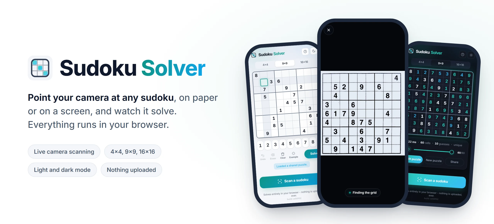
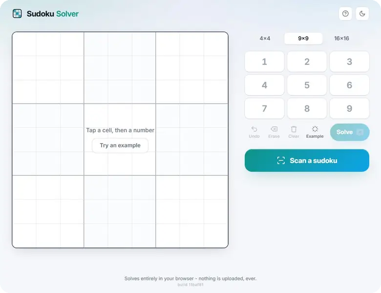
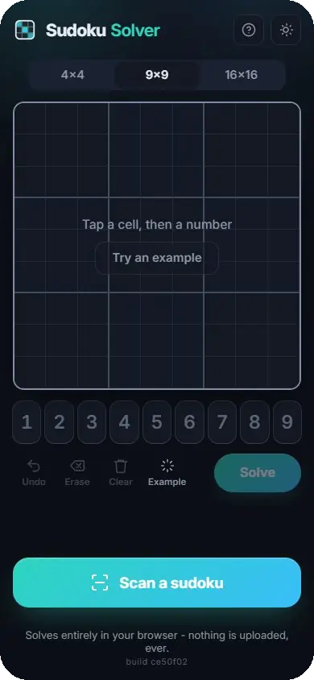
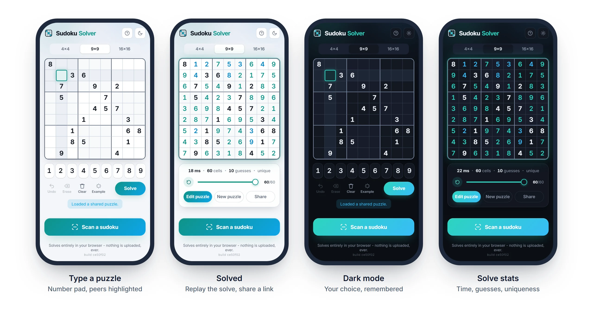
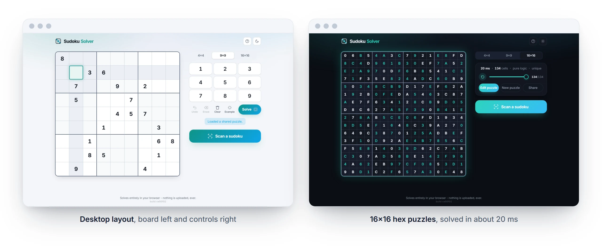
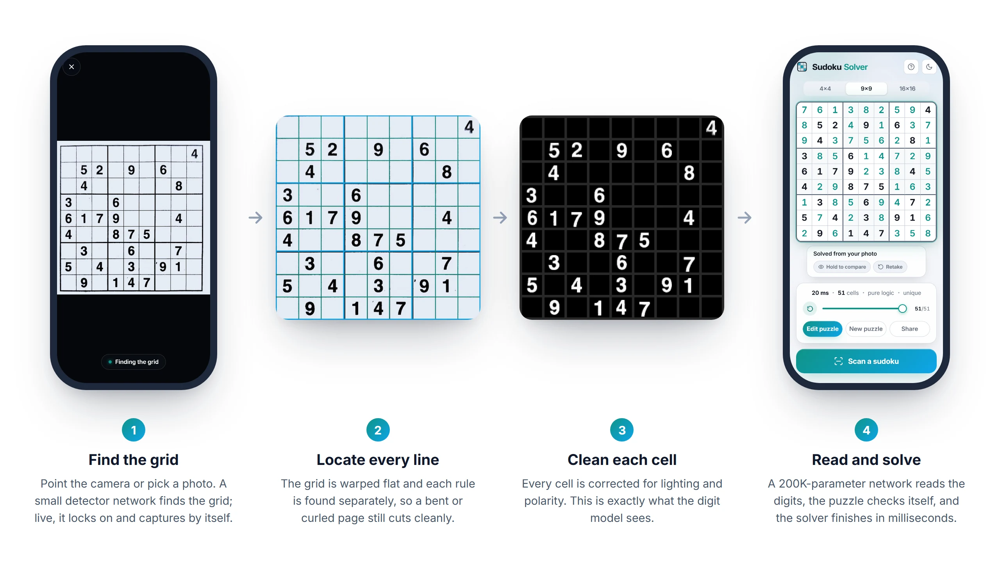
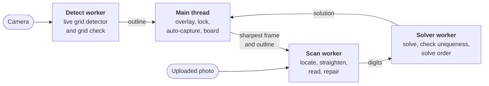

<p align="center">
  <picture>
    <source media="(prefers-color-scheme: dark)" srcset="docs/readme/hero-dark.webp">
    
  </picture>
</p>

<p align="center">
  <a href="https://sudoku-solver.carmodys2014.workers.dev/"><b>Open the app</b></a>
  &nbsp;·&nbsp;
  <a href="#how-the-scanner-works">How it works</a>
  &nbsp;·&nbsp;
  <a href="#development">Development</a>
</p>

A sudoku solver that reads puzzles from your camera. Point your phone at a
newspaper, a book or another screen and it finds the grid, reads the digits
and solves it, all inside the browser. No server, no account, and your
photos never leave the device.

<p align="center">
  
  <br>
  <sub>A photo of a newspaper sudoku dropped onto the page: found, straightened onto the board, read and solved</sub>
</p>

## Features

**Scan with the camera**
- Works on paper and on screens, in light or dark mode, including grids with highlights and pencil notes.
- An outline locks onto the grid and captures by itself once you hold steady.
- The straightened photo flies onto the board and the digits settle in.
- Anything the scanner was unsure of is ringed on the board, and press-and-hold compares it with the photo.
- Grids that spill slightly off the screen still read, and a page with several puzzles lets you pick one.
- You can also upload or drop a photo instead.

<table>
<tr>
<td width="250" align="center"></td>
<td>

**Type and solve**

- 4x4, 9x9 and 16x16 (hex) puzzles, with a number pad, highlighted peers and conflicts, and undo.
- Solving takes milliseconds. The replay slider steps back through the solve order, and a card shows the time, guesses and whether the solution is unique.
- Share any puzzle as a link (`#p=9:53..7....`), or load a curated example such as Arto Inkala's "world's hardest sudoku".

</td>
</tr>
</table>

**Private and fast**
- The solver, computer vision and neural networks run in the browser, in Web Workers.
- It installs as an app (PWA), and after your first scan it works offline.
- The first load is 40 KB of JavaScript (gzipped). The models load only when you scan.

## Screenshots

<picture>
  <source media="(prefers-color-scheme: dark)" srcset="docs/readme/phones-dark.webp">
  
</picture>

<picture>
  <source media="(prefers-color-scheme: dark)" srcset="docs/readme/desktop-dark.webp">
  
</picture>

## How the scanner works

<picture>
  <source media="(prefers-color-scheme: dark)" srcset="docs/readme/pipeline-dark.webp">
  
</picture>

Every panel is the app's own output on a real photo of a newspaper sudoku (the one
behind the Sample button). Panel 3 is exactly what the digit network receives. The
work is split across three Web Workers, so the camera preview stays smooth:



<details>
<summary><b>Technical details</b></summary>

- **Solver.** Bitmask constraint propagation (naked and hidden singles) with
  minimum-remaining-values backtracking. It is complete, checks uniqueness, and
  records the solve order that drives the replay.
- **Grid detection.** Small CNNs propose where the sudoku is, one tuned for the
  live camera and one for still photos. Hand-written computer vision then refines
  and verifies each proposal: adaptive thresholds, contour tracing, per-side
  border fitting, sub-pixel corners and a homography warp. There is no OpenCV and
  no runtime dependency beyond ONNX Runtime.
- **Grid size and lines.** Projection profiles score 4x4, 9x9 and 16x16,
  rewarding the heavier box rules every sudoku prints, with a fallback for faint
  newsprint. Every grid line is relocalised individually. The winning warp gets a
  second look that corrects a corner placed short, and cells are cut along lines
  measured locally, which follow a curled page.
- **Cells.** Each cell is flat-fielded for uneven light, and its polarity is
  judged on its own, so dark themes and highlighted cells read as ink on paper.
  Pencil notes, screened fills and smudges are rejected before the network.
- **Digit reader.** A small CNN with 17 classes (empty, 0-9, A-G), run as int8
  ONNX. Probabilities are taken only over the symbols legal for the grid size.
- **Repair.** An invalid or unsolvable reading triggers a bounded search over the
  least-confident cells for the smallest correction that gives a unique solution.
  A given digit the reader was unsure of is restored when the puzzle's unique
  solution agrees with it. Anything uncertain is flagged on the board.
- **Live camera.** Detection and capture reach 10% past the edges of the view, so
  a grid slightly off the screen still locks. With several puzzles in view, the
  one under the centre wins. Capture takes the sharpest of three frames.
- **Never stuck.** Every worker call has a timeout that replaces a stalled worker
  (iOS kills them silently under memory pressure), and repair runs on a
  wall-clock budget.

</details>

## Try it

The trained models, and the data they were trained and tested on, are not part
of this repository. To scan a puzzle, use the live app:
**[sudoku-solver.carmodys2014.workers.dev](https://sudoku-solver.carmodys2014.workers.dev/)**.

## Tech stack

| Area | Built with |
|---|---|
| App | Svelte 5, TypeScript, Vite, Web Workers, PWA |
| Machine learning | ONNX Runtime Web (WebAssembly) in the browser, int8 models |
| Computer vision | Hand-written in TypeScript, no OpenCV |
| Testing | Vitest, plus Playwright screenshots, screen recordings and a functional audit |
| Hosting | Static files on Cloudflare |

## Repo layout

```
app/                 the site (Svelte + TypeScript)
  src/lib/cv/        grid detection, warping, cell extraction, live detection
  src/lib/ocr/       digit reading, repair, the scan worker
  src/lib/solver/    solver, uniqueness, solve order
  scripts/review/    screenshots, recordings, frame timing and a functional audit
  tests/             solver, computer vision and app tests
docs/readme/         images for this README
```

## Development

```sh
cd app
npm install
npm run dev       # dev server
npm test          # solver, computer vision fixtures, app tests
npm run check     # svelte-check + tsc
npm run build     # production build + PWA, in app/dist
npm run budget    # initial JavaScript size budget
```

Without the models, a local build types and solves puzzles but cannot scan them.

## Credits

- [Inter](https://rsms.me/inter/) for the interface, under the SIL Open Font License (`app/public/fonts/OFL.txt`)
- [ONNX Runtime Web](https://onnxruntime.ai/), [Svelte](https://svelte.dev/) and [Vite](https://vite.dev/)

## Licence

MIT, see [LICENSE](LICENSE).
